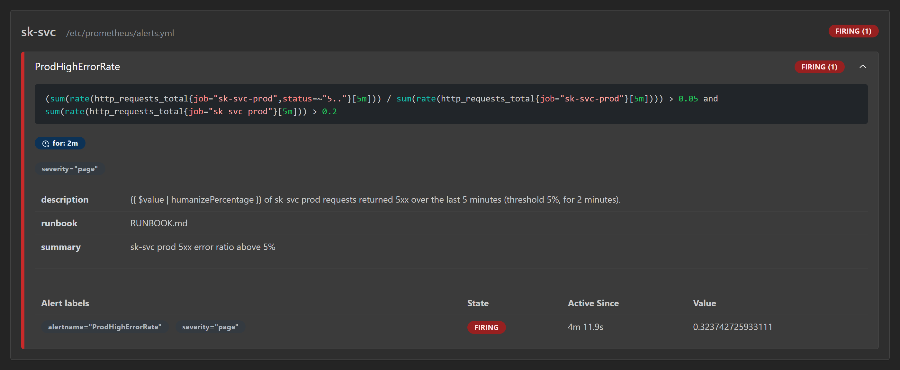
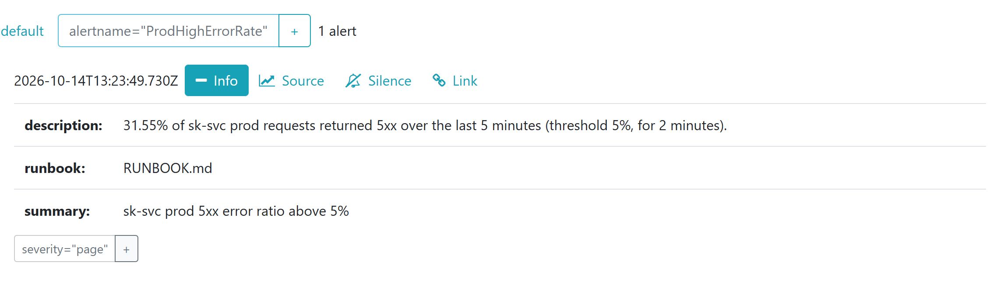
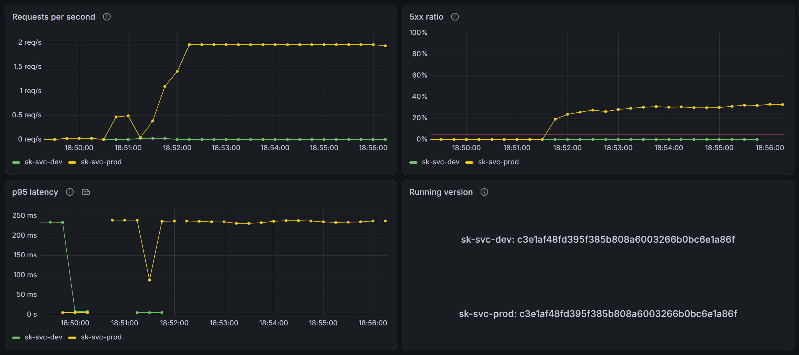

# Evidence

- GitHub repo (public): https://github.com/kaushik-sai/sk-devops-svc
- Azure DevOps project: https://dev.azure.com/sk-genesis/HelloVibe
  - Private, because Microsoft has retired public Azure DevOps projects ([DECISIONS #64](DECISIONS.md)). Reviewers get read access on request.
  - The PR checks are also visible publicly on each GitHub pull request.

All runs ran on the self-hosted agent `sk-local` (Windows laptop, account `svc-azagent`) on 2026-10-14.

## Pipeline runs

### 1. PR blocked by checks

[`sk-svc-pr` run 20261014.5 (build 8)](https://dev.azure.com/sk-genesis/HelloVibe/_build/results?buildId=8) on [PR #4](https://github.com/kaushik-sai/sk-devops-svc/pull/4).

- The change lets `FAIL_RATE` accept values above 1, which `/work` cannot handle.
- Lint passed. **Test: Pester** failed with 196 of 197 tests passing. The failing test is `ConvertTo-FailRate` "falls back to 0 with a warning for 1.5".
- All later steps were skipped.
- GitHub reported the PR as **blocked**, because `sk-svc-pr` is a required check on `main`. The PR was not merged.

### 2. Green deploy to prod

[`sk-svc-main` run 20261014.4 (build 9)](https://dev.azure.com/sk-genesis/HelloVibe/_build/results?buildId=9), for the merge of [PR #3](https://github.com/kaushik-sai/sk-devops-svc/pull/3) (`9e95159`).

1. **Build:** lint, tests, one image `sk-svc:9e95159…`, Trivy image scan.
2. **Dev:** prepare, deploy, smoke test.
3. **Prod:** approval on the `sk-svc-prod` environment, release audit published as the `release-audit-prod` artifact, then deploy, smoke test and old-image clean-up.

The earlier green run [build 6](https://dev.azure.com/sk-genesis/HelloVibe/_build/results?buildId=6), for PR #2, did the same.

### 3. Bad release caught and rolled back

[`sk-svc-main` run 20261014.5 (build 10)](https://dev.azure.com/sk-genesis/HelloVibe/_build/results?buildId=10), queued by hand with `prodFailRate=1`.

- Dev passed.
- In prod, the audit was written and the same image was deployed with `FAIL_RATE=1`.
- **Smoke test: prod** failed: `FAIL work 20 of 20 requests failed`.
- The **Rollback** step ran `Invoke-Rollback -Environment prod`: `Rolling back prod from 9e95159… to ed4fb2f…`. It ended with `Prod now runs: ed4fb2f…`.
- The run ended red, as intended: the release failed, and prod healed itself.

Prod's deploy history afterwards (`C:\svc-app\history\prod.json`):

| Tag | Status | Rolled back from |
|---|---|---|
| `ed4fb2f` | deployed | |
| `9e95159` | rolled_back | |
| `ed4fb2f` | deployed | `9e95159` |

Running `Invoke-Rollback -Environment prod` a second time returned `AlreadyRolledBack`. It made no Docker call and did not change the history.

## Alert firing

Alert drill on the current release (`c3e1af4`): prod set to `FAIL_RATE=0.33`, with `scripts/Send-Traffic.ps1` sending 2 requests per second. `ProdHighErrorRate` went **pending** after about 1 minute and **firing** after about 3 minutes.

**Prometheus**: the rule firing, with its expression, `for: 2m`, `severity="page"`, the runbook link, and an error ratio of 0.32.

**Alertmanager**: the alert received, with `severity="page"`. The description reads "31.55% of sk-svc prod requests returned 5xx".

**Grafana**: prod's 5xx ratio climbs to about 32%, above the red 5% line, while dev stays at 0%. Both environments run `c3e1af4`.

